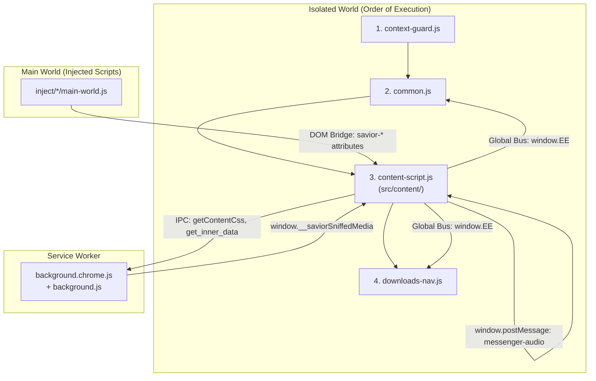
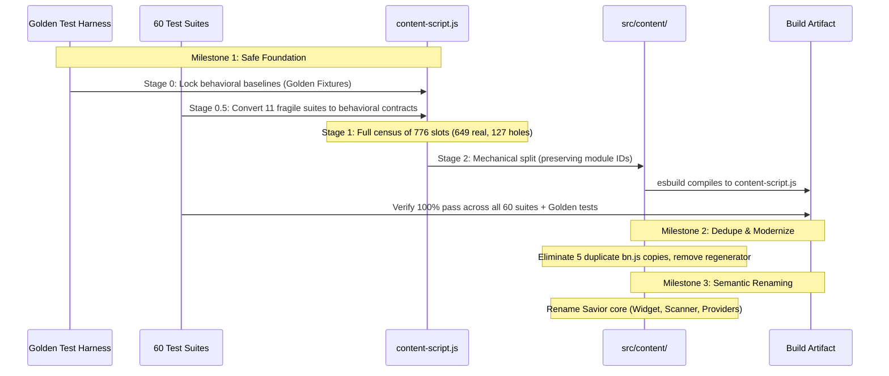

# Architecture Design: Vidown Content Script Modular Open-Source Transformation

- **Date:** 2026-11-01
- **Status:** Draft (Reviewed Gate Version)
- **Target Component:** `content-script.js` (2.4 MB, 649 active modules, 127 holes)
- **Repo:** `DontAskMeWhy0507/Vidown`
- **Specification Path:** `docs/superpowers/specs/2026-11-01-content-script-open-source-architecture-design.md`

---

## 1. Executive Summary & Goals

### 1.1 Context
Vidown currently relies on a 2.4 MB Webpack 4-style IIFE bundle (`content-script.js`) inherited from Cốc Cốc Savior. While dead cryptographic ciphers (TripleDES, Blowfish, Rabbit, RC4Drop) have been successfully purged and key performance guards implemented, the file remains an obfuscated "black box" containing single-letter variable names (`t, e, r, n, i, o, a, s`), inlined regenerator-runtime polyfills, and six near-identical duplicated copies of crypto/math libraries (`bn.js`/`elliptic`).

### 1.2 Primary Objective
Transform `content-script.js` into a 100% transparent, modular, semantically named, and maintainable open-source codebase located in `src/content/`, compiled via a transparent `esbuild` build pipeline into a production release artifact that strictly satisfies all runtime and packaging constraints.

### 1.3 Core Constraints (The Non-Negotiable Triangle)
1. **Zero Functional Regression:** 100% video and audio detection capability must be preserved across all platforms (TikTok, Facebook Reels/Stories, YouTube, Instagram Reels/Stories, Douyin, X, and generic HLS/DASH streams).
2. **100% Test Pass Rate:** All 60 automated test suites (`npm test`) plus new behavioral Golden Tests must pass 100% without waivers or fake passes.
3. **Strict Release Zip Ceiling:** The release zip package must remain $\le 1.15\text{ MB}$ (current HEAD: $1,137,051\text{ B}$ with $\approx 13\text{--}68\text{ KB}$ headroom) with zero `node_modules` and zero test/log artifacts.

---

## 2. Architectural Build Model & Arithmetic Proof

### 2.1 The Standard Open-Source Extension Pattern
- **Source of Truth:** Clean, human-readable, semantically named ES6 source code lives exclusively in `src/content/`.
- **Shipped Release Artifact:** The repository root `content-script.js` is a minified production build artifact generated by `esbuild` from `src/content/`.
  - Format: Single classic IIFE script (Chrome Manifest V3 content scripts cannot run as ES modules and cannot dynamically import chunks at runtime).
  - Target: `chrome116` (the manifest's declared minimum).
  - Explicit Global Exports: The IIFE entry point must explicitly assign cross-file globals (`window.EE`, `window.IS_CONTENT_SCRIPT`, `window._saviorCssCache`, `window._saviorCssCallbacks`, `window._injectSaviorCss`).

### 2.2 Zip Ceiling Arithmetic
- An unminified, multi-line formatted version of `content-script.js` measures $\approx 3.8\text{ MB}$ raw.
- Deflate compression on formatted JavaScript achieves $\approx 4.5:1$ ratio, yielding $\approx 850\text{ KB}$ compressed.
- Adding $850\text{ KB}$ to the existing non-content package assets ($501\text{ KB}$) yields a zip of $\approx 1.35\text{ MB}$, violating the $1.15\text{ MB}$ Web Store limit.
- Conversely, a minified `esbuild` bundle derived from readable sources compresses to $\approx 550\text{--}620\text{ KB}$, keeping the release zip safely at $\approx 1.05\text{--}1.09\text{ MB}$.
- **Conclusion:** Readable source in `src/content/` + minified build artifact at root is the only mathematically sound solution.

---

## 3. The Frozen Contract Surface

Any rebuild or refactoring must strictly honor the external interfaces that interact with other extension files, web pages, and background services:

### 3.1 Manifest Load Order & Globals
- Load sequence: `context-guard.js` $\rightarrow$ `common.js` $\rightarrow$ `content-script.js` $\rightarrow$ `downloads-nav.js` in ISOLATED world at `document_idle`.
- `common.js` executes before `content-script.js`, but calls methods on `window.EE` asynchronously. `content-script.js` initializes `window.EE = window.EE || new EventEmitter()`.
- `downloads-nav.js` reads `window.EE` and attaches `#savior-host` navigators.

### 3.2 DOM Attribute Bridge (MAIN World $\leftrightarrow$ Content Script)
The content script observes and parses attributes stamped by main-world inject scripts:
- `savior-video-detail`: Instagram, Facebook Reels, streamc
- `savior-manifest-url`: Facebook, LinkedIn
- `savior-m3u8`: stream_free
- `savior-decoded-content`: animevietsub
- `savior-story-url`: Facebook Stories
- `savior-po-token`, `savior-youtube-player-response`, `savior-ytb-data-android-solution`: YouTube
- `data-savior-scraped`, `data-savior-token`, `data-savior-css`

### 3.3 Event Bus (`window.EE`) Vocabulary
The 50+ event names must remain exact strings:
`widget.forceUpdate`, `message.background.send`, `widget.updateMedia`, `media-provider.cache.get`, `media-provider.cache.put`, `dom-scanner.node-changed`, `dom-scanner.load`, `dom-scanner.refresh`, `dom-scanner.destroy`, `download`, `location.href.changed`, `pip.on_state_change`.

### 3.4 Chrome API & Messaging
- `chrome.runtime.sendMessage({ action: 'getContentCss', path })`
- `chrome.runtime.onMessage`: Re-emits to `EE` as `message.received`, handles `get_inner_data`.
- `chrome.storage.local`: Settings keys (`on_page_buttons`, `onPageButtonsEnabled`, `detach_enabled`, `image_download_enabled`, `adguardInfo`, `youtubeControls`).

### 3.5 DOM Scanner Observer Configuration
- `MutationObserver` on `document.body` strictly configured with:
  `attributeFilter: ["src", "data-src", "hidden", "opened"]`
  (`style` and `class` mutations are excluded to prevent layout thrashing).

---

## 4. Phased Milestones & Sequencing Correction

To prevent false test failures, we adopt **Sequencing Correction Option 1**: The 11 fragile test suites asserting minified strings are rewritten as behavioral contract tests against the original bundle *immediately after Stage 0*, before any file splitting occurs.

---

### Milestone 1: Safe Mechanical Foundation & Build Pipeline

#### Stage 0: Golden Characterization Tests
- **Objective:** Create automated regression fixtures that execute the actual content script in an isolated DOM environment (using JSDOM with Chrome API mocks).
- **Execution Order:** Load `context-guard.js` $\rightarrow$ `common.js` $\rightarrow$ `content-script.js` $\rightarrow$ `downloads-nav.js`.
- **Minimum Fixture Corpus (Sanitized HTML/JSON):**
  1. TikTok feed/single video.
  2. Facebook Reels.
  3. Facebook Stories.
  4. YouTube watch page.
  5. Instagram feed/Reels.
  6. Generic HLS/m3u8 player.
  7. Vietnamese news/video site (e.g., Motchill / Zing / Tuổi Trẻ).
- **Recorded Baseline Assertions:**
  - Stamped `savior-*` DOM attributes.
  - Emitted `window.EE` events and payloads.
  - `#savior-host` and `.savior-widget` Shadow DOM creation.
  - Messages dispatched via `chrome.runtime.sendMessage`.
- **Mutation Gate (Must Fail when Broken):** Intentionally break one detection rule; the harness must produce visible test failures.

#### Stage 0.5: Fragile-Test Migration
- **Objective:** Eliminate brittle substring assertions in the 11 legacy test suites:
  1. `test_audit_video_lag_and_performance_optimizations.js`
  2. `test_chrome_dashboard_errors_fixed.js`
  3. `test_chrome_extension_errors_permanent_fix.js`
  4. `test_clean_user_flow_and_dead_features.js`
  5. `test_css_import_and_listener_safety.js`
  6. `test_floating_bar_detection_and_gray_button_fix.js`
  7. `test_image_and_video_toggle_settings.js`
  8. `test_reliability_and_bug_fixes.js`
  9. `test_skip_video_removed.js`
  10. `test_tiktok_floating_bar_detection.js`
  11. `test_widget_media_detection_speed.js`
- **Method:** Convert regex/minified substring checks into behavioral contract assertions that execute the module logic or verify structural invariants against the still-original bundle.
- **Mutation Verification:** Spot-check each suite to verify it still catches its respective historical bug.

#### Stage 1: Scope-Aware Module Census
- Parse all 776 slots (649 active `FunctionExpressions`, 127 null holes).
- Generate complete call graph starting from entry point module 543 (`r.s = 543`).
- Identify the exact purpose and callers of modules 37 & 89 (JavaScript parser + code generator, 165 KB combined).
- Produce written byte budget verifying that Milestone 2 deduplication will guarantee $\le 1.15\text{ MB}$ zip size.

#### Stage 2: Mechanical Split & esbuild Assembly
- Decompose 649 modules into `src/content/`:
  - `src/content/entry/` (module 543 + prefetcher + global exports)
  - `src/content/platform/` (EE bus, storage, Chrome API wrappers)
  - `src/content/detector/` (DOM scanner, MutationObserver)
  - `src/content/widget/` (Floating bar UI, Shadow DOM)
  - `src/content/providers/` (per-site extractors)
  - `src/content/crypto/` (AES, base64)
  - `src/content/vendor/` (bn.js, parser/generator, unchanged)
- Preserve numeric module ID mapping table in `src/content/module-registry.js`.
- Configure `esbuild` in `package.json` / `scripts/build.js` to emit root `content-script.js`.
- **Exit Gates:**
  - 100% pass on Golden Tests.
  - 100% pass across all 60 test suites.
  - Release zip rebuilt: $\le 1.15\text{ MB}$, 0 `node_modules`, 0 test/log artifacts.

---

### Milestone 2: Vendor Deduplication & Dead Weight Elimination

#### 2.1 Deduplication Plan
- **Elliptic Family (308 KB):** Consolidate 6 duplicate copies of `bn.js`/`elliptic` (modules 126, 437, 485, 618, 652, 668) into a single pinned, licensed implementation.
- **Regenerator-Runtime Removal (1.2 MB inlined across ~164 modules):** Target `chrome116` natively supports ES2021 `async`/`await`. Eliminate Babel regenerator boilerplate.
- **CryptoJS Consolidation (109 KB):** Retain live AES decryption (modules used in HLS key recovery); ensure 5 dead cipher stubs remain empty.
- **Parser/Generator Evaluation:** If Stage 1 census proves modules 37 & 89 are load-bearing for dynamic script deobfuscation, retain as a clean isolated vendor package; if dead, remove.

#### 2.2 Milestone 2 Gates
- Commit family-by-family.
- Golden tests and all 60 test suites green on every commit.
- Net raw code reduction: $\ge 450\text{ KB}$.

---

### Milestone 3: Semantic Renaming & Core Savior Modules

#### 3.1 Scope of Renaming
- Target: $\approx 100\text{--}150$ genuine core Savior modules (excluding vendored libraries).
- Never rename third-party libraries by hand; replace or vendor them.

#### 3.2 Renaming Order (Leaves First)
1. **Utilities & Shared Helpers:** URL parsers, query selector wrappers, event helpers.
2. **Site Providers:** Domain extractors (YouTube, TikTok, Facebook, Instagram, Motchill).
3. **DOM Detector:** `DomScanner`, MutationObserver handlers, node filtering.
4. **Floating Bar Widget:** Shadow DOM renderer, positioning math, quality menu, click handlers.

#### 3.3 Milestone 3 Gates
- Pure refactoring: variable/function renames and JSDoc documentation only. Zero logic modifications.
- Golden tests and full test suites remain 100% green per commit.

---

## 5. Explicit Out-of-Scope Boundaries

1. **`background.js` (1.15 MB) and `common.js` (518 KB):**
   These files were decompiled with clean indentation, classes, and method names in earlier phases. They remain functional and out of scope for Milestones 1–3. A separate Milestone 4 will address them after `content-script.js` is fully transformed.
2. **Legal Licensing, Copyright & Public Release:**
   Refactoring decompiled code does not alter copyright provenance. The repository remains private. Public licensing (`LICENSE`, `README`, `NOTICE`) will be addressed at the pre-public release gate.
